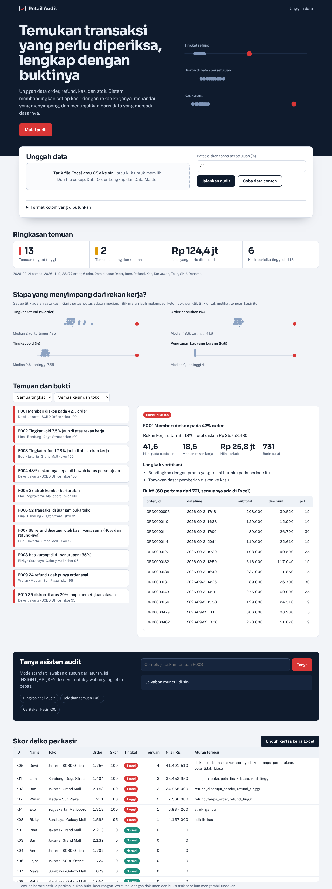

# Retail Audit

Upload retail transaction data (orders, refunds, cash closing, stock count) and get **audit findings with evidence**: which cashier or store deviates from its peers, why, which rows prove it, and what to verify next. An assistant answers questions about the findings, and a working paper can be downloaded as Excel.

Findings mean *needs review*, never *proven fraud*.



## How it detects

Three layers, so each covers the others' blind spots:

| Layer | What it does |
|-------|--------------|
| **Rules** | 15 deterministic checks, each with its evidence rows (table below) |
| **Peer comparison** | Cashier rates (refund, discount, void) are compared to the median of all cashiers with a robust z-score (median and MAD), so a few outliers do not distort the baseline |
| **Anomaly model** | An Isolation Forest over cashier-day behaviour (orders, basket value, refund rate, discount share, void share, off-hours share, cash variance, duplicates). It flags unusual *combinations* that no single rule catches and names the features that drive each flag |

Findings are ranked by score and rolled up into a risk score per cashier (the strongest finding counts fully, further ones with diminishing weight).

| Check | Looks for |
|-------|-----------|
| `refund_tinggi` | Refund rate far above peers |
| `refund_tanpa_order` | Refunds whose order does not exist |
| `refund_sebelum_order`, `refund_terlambat` | Refund before the order, or after the refund window |
| `refund_disetujui_sendiri` | Cashier processes and approves their own refund |
| `refund_tanpa_persetujuan` | Large refunds with no approver |
| `diskon_tanpa_persetujuan` | Discount above the limit without manager approval |
| `diskon_di_batas` | Discounts clustered just under the approval limit |
| `diskon_sering` | Discounts on far more orders than peers |
| `selisih_kas` | Repeated cash shortages at closing |
| `luar_jam_buka` | Orders outside store opening hours |
| `struk_ganda` | Identical receipts repeated within minutes (compared with peers, so natural repeats do not trigger it) |
| `void_tinggi` | Void rate far above peers |
| `integritas_data` | Total ≠ subtotal − discount, or subtotal ≠ sum of items |
| `susut_stok` | Counted stock far below system stock |
| `pola_tidak_biasa` | Anomaly model flags many days for one cashier |

## Assistant

The assistant is an agent with five read-only tools (`summary`, `list_findings`, `get_finding`, `cashier_profile`, `cashier_breakdown`). When a `GEMINI_API_KEY` is set, a Gemini model decides which tools to call, answers in Indonesian citing finding ids and numbers, and every tool call is shown in the UI. Without a key, or if the call fails or times out, the same tools answer from fixed rules, so the page always works. It is told not to accuse anyone and not to recommend drastic actions. With a key, the question and the audit facts the tools return (finding ids, cashier ids and names, amounts) are sent to the Gemini API. See "Asisten Gemini" below.

## Data

Real POS fraud data is confidential and no public dataset has cashier, discount, void, approval and cash-closing fields together, so the sample data is **synthetic**: 28k orders, 18 cashiers, 6 stores, 60 days. Six cashier schemes and one stock-loss hotspot are planted on purpose, and `sample_data/Label_Anomali.csv` records them so the detector can be measured:

```bash
python scripts/generate_sample_data.py   # regenerate
python scripts/evaluate.py               # measure against the planted labels
```

On the sample data the combined detector flags exactly the 6 planted cashiers (6/6 recall, no false positives) and finds the stock-loss store; the anomaly model alone ranks 5 of the 6 in its top 6. These numbers show the method works on data built to contain these patterns. They are not a promise about real data.

Upload two Excel files (or CSV, one table each). Table types are detected from **column names**, so file and sheet names do not matter. Only Order is required; each extra table switches on more checks.

| File | Sheet | Columns |
|------|-------|---------|
| `Data_Order_Lengkap.xlsx` | Order (required) | `order_id, datetime, store_id, cashier_id, subtotal, discount, total` (optional: `shift, payment_method, voided, discount_approved_by`) |
| | Item | `order_id, sku, qty, unit_price` |
| | Refund | `refund_id, order_id, datetime, store_id, cashier_id, amount` (optional: `approved_by, sku, qty, reason, resellable`) |
| | Setoran_Kas | `date, store_id, cashier_id, expected_cash, actual_cash` (optional: `shift`) |
| `Data_Master.xlsx` | Karyawan | `employee_id, nama, store_id, peran` |
| | Toko | `store_id, store_name` (optional: `jam_buka, jam_tutup`) |
| | SKU | `sku, name, price, unit_cost` |
| | Opname | `store_id, sku, system_qty, counted_qty` |

## Run

```bash
python -m venv .venv
source .venv/bin/activate          # Git Bash on Windows: source .venv/Scripts/activate
pip install -r requirements-dev.txt
uvicorn app.main:app --reload      # http://localhost:8000
```

Docker: `docker compose up --build`. Updating: `git pull origin main`, then restart.

| Variable | Default | Description |
|----------|---------|-------------|
| `GEMINI_API_KEY` | none | API key Gemini untuk asisten (`GOOGLE_API_KEY` juga dikenali). Tanpa key, jawaban standar dipakai |
| `GEMINI_MODEL` | `gemini-3.5-flash` | Model Gemini yang dipakai (harus mendukung function calling) |
| `AGENT_TIMEOUT_SECONDS` | `90` | Tunggu per percobaan sebelum memakai jawaban standar |
| `ASSISTANT_MODE` | none | Isi `rules` untuk mematikan Gemini dan selalu memakai jawaban standar |

## API

Docs at `/docs`. `POST /api/analyze` (files, `discount_limit`), `POST /api/analyze/sample`, `POST /api/ask` (`job_id`, `question`), `GET /api/report/{job_id}.xlsx`, `GET /api/schema`, `GET /sample/{name}`.

## Tests

`pytest` (20 tests): planted cashiers found without false positives, each scheme maps to its rule, evidence matches the claim, clean data stays quiet, assistant fallback, timeout and failure paths, API and upload validation.

## Limitations

- Statistical flags need volume: with few cashiers or short history, peer comparison is weak.
- A flag is a lead. Legitimate causes exist (promotions, training, a busy day) and the verification steps exist to rule them out.
- Without cashier, approval and timestamp columns, the corresponding checks do not run.
- Results are kept in memory for one hour.

## Asisten Gemini

Asisten memakai Gemini API. Buat API key di https://aistudio.google.com/apikey, lalu:

```bash
cp .env.example .env        # isi GEMINI_API_KEY di file .env
uvicorn app.main:app --reload
```

Di Windows PowerShell: `$env:GEMINI_API_KEY="..."` sebelum menjalankan `uvicorn`. Dengan Docker, `docker compose up --build` membaca `.env` otomatis.

Data kasir dan temuan diambil dulu, lalu model boleh memanggil 5 alat baca-saja (maksimal 3 putaran). Jika gagal, dicoba lagi sekali tanpa alat. Jika key kosong, salah, kuota habis, atau Gemini tidak terjangkau, jawaban standar tampil dengan "penyebab teknis" (key tidak pernah ditampilkan). Jika nama model sudah tidak tersedia, ganti `GEMINI_MODEL`.

**Privasi:** saat key diisi, pertanyaan dan hasil alat (id temuan, id dan nama kasir, nilai rupiah, nama produk) dikirim ke Gemini API. Isi `ASSISTANT_MODE=rules` bila data tidak boleh keluar dari komputer.
